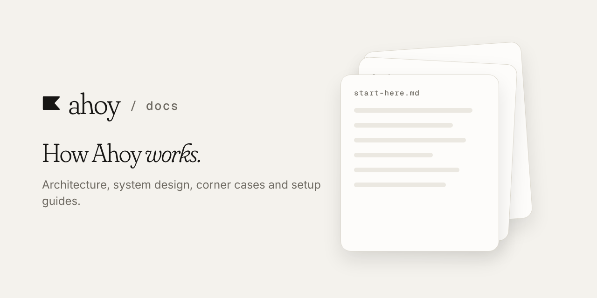

**Ahoy** is a voice assistant that lets you control your Mac from your phone. This repo explains how it's built.

[▶ Watch the 1:45 demo](https://drive.google.com/file/d/1JMgSd2bm7LtUCs2WxiTNWuo0-bijqs4p/view?usp=sharing) · [All Ahoy repos](https://github.com/getahoy)

# Ahoy — specification

Talk to your Mac from your phone. It acts on what is currently on screen.

## Read in this order

| Doc | What it is |
|---|---|
| [start-here.md](start-here.md) | The whole project in a few minutes |
| [system-design.md](system-design.md) | HLD and LLD: ports, latency, data model, OS segregation |
| [corner-cases.md](corner-cases.md) | Problem and fix tables, filtered by feature |
| [setup-guide.md](setup-guide.md) | Hands-on Expo and Swift setup |
| [everything.md](everything.md) | Every decision and the reasoning behind it |
| [KICKOFF.md](KICKOFF.md) | The brief handed to Claude Code |
| [archive-full-architecture.md](archive-full-architecture.md) | Long-form reference |

## Repos

| Repo | What |
|---|---|
| `getahoy/docs` | This |
| `getahoy/shared` | `@getahoy/protocol`, `crypto`, `lib` |
| `getahoy/mobile` | Expo, iOS and Android |
| `getahoy/agent` | Electron plus the Swift helper |
| `getahoy/web` | Next.js site, auth, API |
